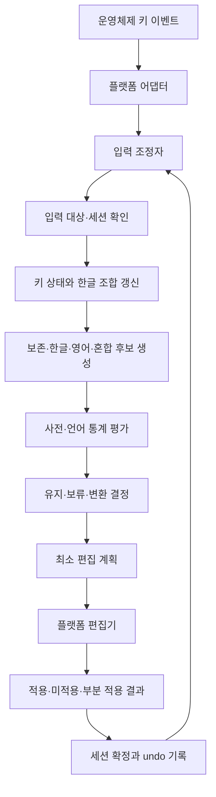

# Amu 구현 구조 제안

이 문서는 전체 목표 구조다. Rust/libhangul과 macOS 첫 구현의 완료 범위는 [MVP 구현 현황](mvp.md)에 구분해 기록한다.

## 결정: 운영체제 독립 코어, 운영체제별 입력 연결

macOS부터 검증하되 macOS 전용 엔진은 만들지 않는다. UNIX/POSIX는 프로세스·파일·소켓 등의 공통 기반이지, 다른 앱의 텍스트를 조합하고 바꾸는 단일 입력기 API가 아니다. Linux와 macOS도 이 부분을 공유하지 않는다.

| 경계 | 공통으로 구현 | 따로 구현 |
|---|---|---|
| 한영 판단 | 키 배열 해석, 한글 조합, 사전·통계, 후보 분절, 문맥 판단 | 해당 없음 |
| 상태와 복구 | 입력 세션, 보류 결정, 편집 계획, undo 기록 | 포커스/커서 변경의 감지 방법 |
| 실제 입력 | 플랫폼 중립 이벤트·편집 계약 | 키 수신, 조합 표시, 텍스트 반영, 권한, 암호 필드 |
| 제품 외피 | 설정 의미와 데이터 포맷 | 메뉴바/트레이, 설치·업데이트·시작 프로그램 |

공식 입력기 선택지는 macOS [InputMethodKit](https://developer.apple.com/documentation/inputmethodkit/imkinputcontroller?language=objc), Windows [TSF](https://learn.microsoft.com/en-us/windows/desktop/TSF/text-services-framework), Linux [IBus](https://github.com/ibus/ibus) 등이다. 이벤트 훅과 키 재주입은 별도 통합 방식이며 공식 입력기와 동작 계약이 다르다. Windows 앱용 IME는 [Microsoft의 TSF 요구사항](https://learn.microsoft.com/en-us/windows/apps/develop/input/input-method-editor-requirements)을 따른다.

첫 플랫폼은 사용 환경에 맞춰 macOS로 한다. 조합 신뢰성 조사를 반영해 **공식 입력기(InputMethodKit) 통합 실험을 우선**한다. Amu를 입력 소스로 한 번 선택한 뒤 내부에서 한영을 자동 판단한다. 공식 입력기는 조합을 호스트와 협력해 다루지만 앱 호환성이 자동으로 해결되지는 않는다. 이벤트 훅은 이 실험에서 드러나는 지원 범위에 따라 검토한다.

공통 코어의 언어는 Rust를 우선 후보로 둔다. 이유는 macOS·Windows·Linux·WASM에 같은 코어를 연결하는 배포 경계를 만들기 좋고 세션의 소유권을 명시할 수 있기 때문이다. Rust를 선택한다는 사실이 Swift보다 빠르다는 근거는 아니다. 실제 선택은 작은 코어와 macOS·Windows의 C ABI 연결 실험으로 확정한다. UI와 키 훅을 코어 언어로 통일할 필요는 없다.

후속 구체안은 **Rust 코어 + Swift macOS 연결부 + Rust/windows-rs Windows 연결부**다. [한글 조합·상태 전이·비용 설계](composition-design.md)에 두벌식 입력과 Backspace 처리, 네이티브 연결 경계를 정리했다. Windows 연결부는 같은 Rust 코어를 직접 호출하므로 언어 간 C ABI는 macOS 연결에 우선 필요하다.

## 실행 흐름



진입점은 위 순서가 직접 읽히도록 작성한다. 함수는 의미 있는 한 단계를 맡고, 구현을 숨기는 전달용 래퍼는 만들지 않는다. 단순 문자 매핑·산술까지 클래스로 분리하지 않는다.

## 책임 경계

| 모듈 | 한 가지 책임 | 맡기지 않는 책임 |
|---|---|---|
| `KeyboardLayout` | 물리 키와 Shift를 배열상의 문자로 해석 | 언어 의도 추측 |
| `HangulComposer` | 두벌식 조합과 한 키 삭제 | 사전 조회, OS 편집 |
| `CompositionSession` | 완료 음절·조합 중 토큰·호스트 확정 경계 관리 | 언어 점수 계산, OS API 호출 |
| `LiteralPolicy` | URL·명령 옵션·사용자 보존 규칙 평가 | 문장 전체 언어 선택 |
| `CandidateGenerator` | 같은 키열의 영어·한글·혼합 분절 생성 | 실제 글자 변경 |
| `LanguageScorer` | 불변 사전·통계로 후보별 근거 점수 계산 | 변환 임계값 결정 |
| `ContextDecoder` | 제한된 이전 단어와 현재 후보의 경로 평가 | 포커스 추측, 파일 저장 |
| `DecisionPolicy` | 변경 비용·확신·사용자 의도에 따라 결정 | 후보 재생성 |
| `EditPlanner` | 기존 표시와 목표 표시의 최소 변경 계산 | 키 이벤트 전송 |
| `UndoJournal` | 실제 적용된 변경과 역변환 이력 관리 | 사용자 사전 파일 쓰기 |
| `InputSession` | 해당 입력 대상의 상태 전이와 수명 관리 | 전역 키 수신 |
| `InputCoordinator` | 대상 확인→엔진 호출→편집→결과 반영 | 한글 알고리즘 구현 |
| 플랫폼 `TextEditor` | 계획을 적용하고 관찰 가능한 결과 반환 | 언어 판단 |
| `PreferencesStore` | 설정·개인 사전 영속화 | 키마다 동기 I/O |

처음부터 모듈마다 패키지·인터페이스를 만들지는 않는다. 코어 내부의 순수 함수는 직접 호출하고, 실제 교체 대상인 플랫폼 입력/편집과 데이터 공급 경계에만 인터페이스를 둔다. 사전은 조회용 불변 데이터로 전달한다.

SOLID는 다음과 같이 적용한다.

- SRP: 조합·판별·결정·편집·기록이 서로 다른 변경 이유를 가진다.
- OCP: 새 OS와 새 점수 모델은 자신의 경계에서 추가한다. 공통 정책을 플랫폼마다 복제하지 않는다.
- LSP: 모든 편집기는 같은 성공/부분 적용 계약을 지킨다. 지원하지 않는 원자적 편집을 성공으로 가장하지 않는다.
- ISP: 입력 수신, 대상 읽기, 편집 능력을 작은 계약으로 나눈다. 단일 거대 `Platform` 객체를 넘기지 않는다.
- DIP: 코어가 AppKit·Win32·IBus를 import하지 않는다. 조정자가 외부 효과를 연결한다.

## 결과 계약과 상태 소유권

아래는 설계 표현이며 구현한 API가 아니다.

```text
Decision =
  Keep(reason)
  Defer(reason, reconsiderAt)
  Replace(targetText, sourceKeyRange, reason)
  Blocked(reason)

EditPlan =
  sessionId + focusGeneration + expectedRevision
  expectedSuffix + replacementText
  originalKeyDisposition + undoRecordCandidate

ApplyReceipt =
  Submitted(operationId)
  Confirmed(observedRevision)
  Unchanged(reason)
  Partial(observedText, reason)
```

원시 키, 조합 상태, 최근 단어, 보류 후보, undo는 입력 세션 하나가 소유한다. 세션은 앱만으로 식별하지 않는다. 동일 앱의 다른 입력칸과 포커스 세대도 구별한다. 앱 전환·커서 이동·선택·붙여넣기·호스트 자동완성이 관찰되면 수정 가능한 문맥을 제한하거나 폐기한다.

코어의 계산 결과와 실제 화면 반영을 구별한다. 엔진이 예상한 글이 아직 반영되지 않았다면 편집을 겹쳐 보내지 않는다. 늦게 도착한 결과는 generation/revision이 맞을 때만 확정한다. 실패나 부분 적용에서는 세션을 재동기화하며, 같은 삭제를 무조건 재시도하지 않는다.

플랫폼 API 호출이 반환됐다는 사실만으로 `Confirmed`를 만들지 않는다. 자체 operationId/revision은 작업 순서를 나타내며 호스트가 제공한 버전 번호가 아니다. 플랫폼이 읽기·알림으로 확인할 수 있는 범위만 보고한다. 일반 IME 조합 업데이트는 순서대로 제출하되, 확인할 수 없는 과거 확정 텍스트의 자동 재편집은 보류한다. 조합 이벤트의 재진입·외부 확정 요청도 같은 세션 상태 전이로 처리한다.

키 훅은 이미 소비한 키를 나중에 원본 이벤트처럼 통과시킬 수 있다고 가정하면 안 된다. 편집 후 공백 전달이 필요한 경우 순서까지 출력 계약에 포함한다. 편집 실패 시 재주입 여부는 키가 이미 소비/전달됐는지에 따라 결정하며 중복 입력을 방지한다.

텍스트 좌표도 분리한다. raw key offset, UTF-8 byte, UTF-16 code unit, grapheme count는 서로 다르다. 코어는 키 범위와 조합 결과의 대응을 유지하고, 어댑터는 호스트 좌표로 변환한다. emoji·결합 문자·Hangul 자모를 단순 UTF-16 길이만으로 삭제하지 않는다.

## 더 나은 성능을 만들 구체적 후보

| 후보 | 기대 효과 | 채택 조건 |
|---|---|---|
| 키 추가/삭제에 대한 증분 한글 조합 | 전체 키열 재조합 감소 | 조합·분해의 모든 경계 유지 |
| 현재 접두어의 사전 상태와 n-gram 누적값 보관 | 문자열 할당·반복 조회 감소 | backspace/undo 이후 동일 결과 |
| 제한된 문맥·후보 수 | 최악 지연과 메모리 상한 | 모호한 경우 억지 변환 대신 보류 |
| 불변 압축 사전·연속 배열 통계 | 캐시 지역성, 초기화 비용 개선 | 실제 데이터에서 크기/속도 측정 |
| 세션별 독립 상태 핸들 | 세션 교대 시 전체 이력 재생 제거 | 동시 세션·포커스 복귀 결과 동일 |
| 최소 suffix 편집과 확인된 undo | 삭제량·깜빡임·오염 축소 | 호스트 변형·포커스 변경 시험 |
| 편집 판단에서 변경 비용 반영 | 짧은 영어의 불필요한 변환 감소 | 한국어 복구율을 함께 측정 |

우선 지표는 **오변환/1,000토큰, 올바른 변환 recall, 안정된 화면까지의 시간, 원문 손실/중복 0건**이다. 엔진 warm p50/p95/p99, cold init, RSS, idle CPU는 따로 기록한다. 비교는 같은 장비·입력·경계 시점으로 수행하고, 개선에 쓴 문장과 최종 평가 문장을 분리한다.

키마다 디스크·네트워크·모델 로딩을 하지 않는다. 작은 판별을 매번 다른 프로세스나 worker로 보내는 설계도 기본값으로 삼지 않는다. 모델·개인 사전 갱신만 뒤에서 준비하고 키 처리에는 불변 snapshot을 공급한다.

## 구현 순서와 완료 기준

1. **기준 조합기와 세션:** libhangul 백엔드, 영어/한글 후보, keep/defer/replace, 입력 trace runner. 브라우저나 OS 없이 테스트한다. 데이터와 평가 말뭉치 출처를 함께 기록한다. 독립 Rust 조합기는 차등 검증이 준비된 뒤 별도로 판단한다.
2. **복구와 편집:** 혼합 분절, 최근 문맥, 최소 편집, undo, 모의 편집기의 미적용·부분 적용·포커스 전환. UI 없이 원문 보존과 순서를 검증한다.
3. **macOS 통합 실험:** 공식 입력기로 TextEdit·Firefox/Chrome/Safari 입력칸·contenteditable·터미널·VS Code/Electron의 조합·자동완성·키 폭주를 확인한다. 한 단어를 조합 중으로 유지하는 정책까지 검증하고, 호환성 제약에 따라 훅 방식의 추가 실험 여부를 결정한다.
4. **Windows 연결 검증:** macOS 기능이 크게 늘기 전에 동일 코어를 Windows 빌드와 작은 TSF 호스트에 연결한다. OS 종속 설계가 코어에 새는지 일찍 확인한다.
5. **제품 외피:** 메뉴바/트레이, 앱별 정책, 예외·강제 변환 관리, 시작 프로그램·업데이트. 설정 UI의 단순 수정에는 별도 단위 테스트를 만들지 않는다.
6. **성능 평가:** 코어 trace에서 판독 정확도와 키 처리 지연을 측정하고, 플랫폼 연결부는 실제 앱별 종단 지연·입력 손실 시험으로 평가한다. 코어 처리 시간과 실제 화면 반영 시간을 구분한다.

첫 Rust/libhangul 엔진과 macOS·Windows 어댑터는 구현했고 단어 등록 없이 영문 특성·한국어 음절 통계·최근 언어 경향을 비교하는 양방향 분절을 추가했다. Windows는 같은 C ABI를 사용하며 키 번역·코어 수명·TSF 조합 범위·COM 등록을 분리했다. CI에서 x64·x86 빌드와 등록된 입력기의 키 전달·편집·설치 실패 복구를 검사한다. 문장 의미 모델, 여러 번 교차하는 혼합 분절, 확정 텍스트의 안전한 재편집, 외부 앱별 호환성 행렬은 아직 완료하지 않았다. 전체 설계나 성능 우위가 검증됐다는 뜻은 아니다.
